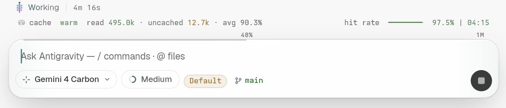

# tern-agy-cache

<p align="center">
  <b>Native prompt-cache meter for Google Antigravity (<code>agy</code>) inside <a href="https://stencil.so/tern">Tern</a>.</b><br>
  Live hit-rate bar right above every <code>agy</code> composer, calibrated 5-minute TTL countdown, widget-bar meter, and per-turn breakdown canvas.
</p>

<p align="center">
  English · <a href="README.zh-CN.md">简体中文</a>
</p>

<p align="center">
  <a href="LICENSE"></a>
  
  
  
</p>

<p align="center">
  
</p>

---

When running **Antigravity CLI (`agy`)** as a native ACP agent inside [Tern](https://stencil.so/tern), existing prompt-cache plugins (`omp-cache-meter`, `claude-cache-meter`) only cover `omp` and Claude Code. **`tern-agy-cache`** brings the same crisp, zero-clutter instrument strip natively to every `agy` pane:

- **Inline Composer Strip (per-pane, split-safe)** — Renders `⛁ cache · stage · read · uncached · avg` and `hit rate ━━━━━━━━ % | MM:SS` directly above each `agy` composer's context hairline without disturbing `omp` panes beside it, even when `agy` is unfocused in a split view.
- **Empirically Calibrated 5-Minute Implicit-Cache TTL** — Unlike Anthropic's 1-hour extended cache, Antigravity relies on server-side implicit KV prefix caching whose real retention cliff sits at **~5 minutes** (measured across 950+ live turns: `98.4%` hit `<1m`, `91.3%` `1–2m`, `82.8%` `2–3m`, dropping to `~0%` past `6m`). Tracks `warm`, `primed` (fresh prefix built on cold/model switch), `expiring` (`<1:00`), and `cold`.
- **Widget Bar Meter (`agy-cache/hit`)** — Offers `ring`, `bar`, `text`, and 24-turn sparkline `graph` styles for Tern's bottom widget bar.
- **Native Per-Turn Details Canvas & Optional Expiry Toast** — Inspect the latest 12 turns (`Step`, `Hit`, `Cached`, `Uncached`, `Out`) in a native Tern canvas, and optionally enable a 1-minute pre-expiry toast for background panes.
- **Event-Driven & Cross-Platform (Linux, macOS & Windows)** — Zero background `.jsonl` file polling; refreshes on Tern lifecycle events (`agent_finished`, `agent_state`, `focus`, `window_start`) by mapping live `agy acp` panes (`Linux /proc`, `macOS ps + lsof`, or `Windows CIM + SQLite metadata`) to `~/.gemini/antigravity-cli/brain/<id>` transcripts using Python 3.10+ stdlib only.

## Install

```sh
tern plugin install github.com/ninthcj/tern-agy-cache
```

Verify the plugin is loaded:

```sh
tern plugin list
# agy-cache 0.1.0 Antigravity Cache — 0 blocks, 0 lenses, window  ready
```

*(Optional)* To also place the ring/sparkline meter on Tern's bottom widget bar, open the Command Palette → **`Edit widgets…`** and drag **`Antigravity Cache`** (`agy-cache/hit`) into the bar.

## Command Palette Actions

| Command | Description |
|---|---|
| `Antigravity Cache: Show details` | Open native side canvas with session KPIs and recent 12-turn token table |
| `Antigravity Cache: Toggle composer bar` | Show or hide the inline bar above `agy` composers (persisted in `tern.kv`) |
| `Antigravity Cache: Toggle 1-minute expiry toast` | Toggle background-pane expiry toast at `01:00` remaining (default: off) |

## Empirical TTL Reference (Antigravity Implicit Caching)

| Idle Gap (Same Model) | Observed Hit Rate | Stage Shown |
|---|---|---|
| `0 – 1 min` | ~98.4% | `warm` (`primed` if `read = 0` on initial/switched turn) |
| `1 – 3 min` | ~82% – 91% | `warm` |
| `4 – 5 min` | ~35% – 62% | `expiring` (`< 01:00` left) |
| `> 6 min` | ~0% | `cold` |

## Development & Tests

```sh
git clone https://github.com/ninthcj/tern-agy-cache.git
tern plugin link ./tern-agy-cache
python3 -m unittest discover -s tests -v
```

## Pair With

- **[tern-wingman](https://github.com/ninthcj/tern-wingman)** — Drive a live side-pane or Picture-in-Picture `omp` worker from `agy` over native Tern TSP (`WindowCx.agents`).

## License

[MIT](LICENSE) © [ninthcj](https://github.com/ninthcj)
