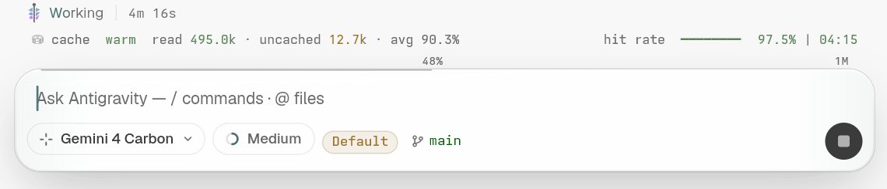

# tern-agy-cache

<p align="center">
  <b>专为 <a href="https://stencil.so/tern">Tern</a> 打造的 Google Antigravity (<code>agy</code>) 原生提示词缓存命中率仪表条。</b><br>
  直接在每个 <code>agy</code> 输入框上方渲染实时缓存命中率、实测校准的 5 分钟 TTL 倒计时、底栏环形/折线组件与逐轮明细面板。
</p>

<p align="center">
  <a href="README.md">English</a> · 简体中文
</p>

<p align="center">
  
</p>

---

在 [Tern](https://stencil.so/tern) 里使用原生 ACP 界面运行 **Antigravity (`agy`)** 时，社区现有的缓存插件只覆盖了 `omp` 和 Claude Code。**`tern-agy-cache`** 为每一块 `agy` 面板补齐了风格完全统一的原位缓存仪表条：

- **输入框外上方原位显示（支持双分屏独立常驻）**：在每个 `agy` 输入框上下文细线正上方直接绘制 `⛁ cache · 状态 · read · uncached · avg` 与 `hit rate ━━━━━━━━ % | MM:SS`；即使在左 `agy` 右 `omp` 分屏下失焦也常驻显示，且绝不干扰右侧 `omp` 面板。
- **基于 950+ 轮真实日志校准的 5 分钟隐式缓存倒计时**：不同于 Anthropic 的 1 小时扩展缓存，Antigravity 采用后端隐式 KV 前缀缓存，实测存活悬崖在 **5 分钟**左右（`<1m` 命中率 `98.4%`，超过 `6m` 降至 `~0%`）。自动区分 `warm`（热命中）、`primed`（冷启动或切模型刚建好新前缀）、`expiring`（剩余 `<1:00`）与 `cold`（已过期）。
- **底栏多样式原生组件（`agy-cache/hit`）**：支持 `ring`（圆环）、`bar`（进度条）、`text`（纯文本）与 `graph`（近 24 轮命中率折线图）四种 Tern 原生底栏样式。
- **逐轮 Token 明细面板 & 可选过期提醒**：点击组件或通过命令面板打开侧边原生 Canvas 查看最近 12 轮的 `Cached / Uncached / Out` 明细表；支持按需开启后台面板剩余 1 分钟过期 Toast 提醒。
- **纯事件驱动、零轮询扫盘（全平台支持 Linux、macOS 与 Windows）**：仅依赖 Python 3.10+ 标准库，在 `agent_finished`、`focus` 等原生生命周期事件时精准关联面板进程与会话日志（Windows 下自动适配 `python` / `py -3` 启动器与无黑窗 CIM + SQLite 元数据反查）。

## 一键安装

```sh
tern plugin install github.com/ninthcj/tern-agy-cache
```

本地源码链接开发：

```sh
git clone https://github.com/ninthcj/tern-agy-cache.git
tern plugin link ./tern-agy-cache
```

*(可选)* 如需同时放到 Tern 底部状态栏，打开命令面板运行 **`Edit widgets…`**，将 **`Antigravity Cache`** 拖入底栏即可。

## 命令面板操作

- **`Antigravity Cache: Show details`**：打开侧边原生明细面板，查看会话汇总与最近 12 轮命中记录
- **`Antigravity Cache: Toggle composer bar`**：显示 / 隐藏输入框上方的缓存仪表条（自动持久化到 `tern.kv`）
- **`Antigravity Cache: Toggle 1-minute expiry toast`**：开启 / 关闭后台面板剩余 1 分钟过期提醒（默认关闭）

## 搭配推荐

- **[tern-wingman](https://github.com/ninthcj/tern-wingman)**：在 Tern 里用 `agy` 主控通过原生 TSP 协议分屏或画中画调度右侧 `omp` 僚机。

## 开源协议

[MIT](LICENSE) © [ninthcj](https://github.com/ninthcj)
